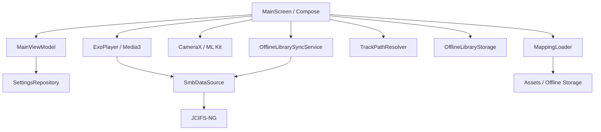
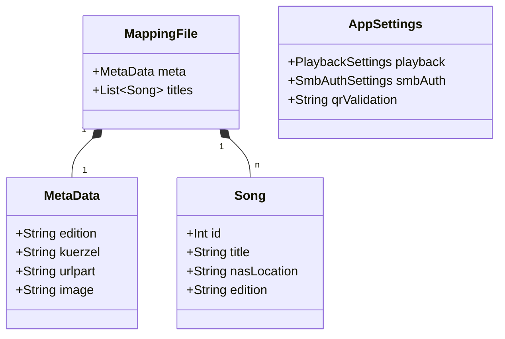
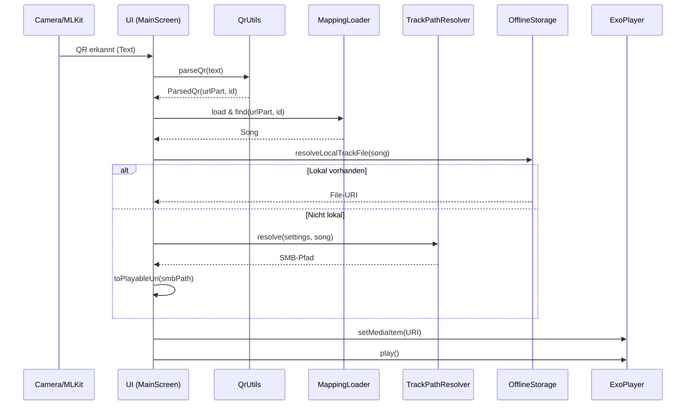

# Architektur-Analyse: Play My Music

Diese Analyse beschreibt die aktuelle Ist-Architektur des Projekts basierend auf dem Code.

## 1. Modulübersicht

Das Projekt ist in zwei Hauptmodule unterteilt:

### [Module] :core (Android Library)
Verantwortlich für die plattformunabhängige Business-Logik und Datenmodelle.
- **mapping**: `MappingLoader` (Parsing), `TrackPathResolver` (Pfad-Generierung).
- **model**: Definition von `Song`, `MappingFile`, `PlaybackSettings`.
- **qr**: `QrUtils` für das Parsen der QR-Inhalte.

### [Module] :app (Android Application)
Verantwortlich für UI, Hardware-Interaktion und Plattform-spezifische Services.
- **camera**: `CameraPreview` (CameraX & ML Kit Barcode Scanning).
- **player**: `SmbDataSource` (Media3/ExoPlayer Integration für SMB).
- **offline**: `OfflineLibrarySyncService` und `OfflineLibraryStorage`.
- **settings**: `SettingsRepository` (DataStore) und Defaults-Handling.
- **ui**: Jetpack Compose Screens (`MainScreen`, `SettingsScreen`).

---

## 2. Datenfluss / Runtime Flow

Der Prozess von der Erfassung eines QR-Codes bis zur Wiedergabe folgt diesem Pfad:

1.  **QR-Scanning**: ML Kit erkennt einen Barcode.
2.  **Parsing**: `QrUtils.parseQr` extrahiert den `urlPart` (optional) und die `trackId`.
3.  **Mapping-Lookup**:
    -   `AssetMappingLoader` sammelt JSON-Dateien aus Assets und dem lokalen Offline-Speicher.
    -   `MappingLoader.parse` erzeugt eine Map von `SongKey` zu `Song`.
    -   Der `Song` wird über `(urlPart, trackId)` identifiziert.
4.  **Pfadbau / Auflösung**:
    -   **Schritt A**: `OfflineLibraryStorage` prüft, ob die MP3-Datei lokal im Offline-Ordner existiert.
    -   **Schritt B (Fallback)**: Wenn nicht lokal, nutzt `TrackPathResolver.resolve` die NAS-Einstellungen (`nasAddress`, `nasBaseFolder`), um einen SMB-Pfad zu generieren.
5.  **SMB-URI-Generierung**: Der Pfad wird in eine `smb://`-URI umgewandelt.
6.  **Wiedergabe**: `ExoPlayer` nutzt die `SmbDataSource`, um den Stream über das SMB-Protokoll (via `jcifs-ng`) zu laden.

---

## 3. Mapping-Handling

-   **Laden**: `AssetMappingLoader` durchsucht `assets/mappings`, `assets/local/mappings` und `filesDir/offline-library/editions/*/`.
-   **Filter**: Es werden nur Dateien berücksichtigt, die mit dem in den Einstellungen definierten `mappingFilePostfix` übereinstimmen.
-   **JSON-Struktur**:
    -   `meta`: Enthält `edition`, `kuerzel` (Abkürzung), `urlpart` und `image` (Cover).
    -   `titles`: Liste von `Song`-Objekten mit `id`, `title`, `artist` und optionaler `nasLocation`.
-   **nasLocation**: Wenn dieses Feld im Song gefüllt ist, wird es als relativer Pfad zur Edition auf dem NAS verwendet und überschreibt die Standard-Pfadstruktur.

---

## 4. Pfadbau / SMB-URI-Generierung

Die Generierung erfolgt in `TrackPathResolver`:
- **Basis**: `nasAddress` + `nasBaseFolder`.
- **Struktur**: `{Address}/{BaseFolder}/{Edition}/tracks/{ID_padded}.mp3`.
- **Padding**: Die Track-ID wird standardmäßig auf 4 Stellen aufgefüllt (z.B. `0001.mp3`), konfigurierbar über `trackIdPadding`.
- **URI-Konvertierung**: `toPlayableUriOrNull` wandelt UNC-Pfade (`\\host\share`) in das für JCIFS nötige `smb://`-Format um.

---

## 5. Offline-Sync

-   **Service**: `OfflineLibrarySyncService` synchronisiert Metadaten (JSON & Bilder) und optional Tracks.
-   **Struktur**: `context.filesDir/offline-library/editions/{EditionName}/`.
-   **Priorisierung**: Bei der Wiedergabe prüft die App in `MainScreen.playSong` zuerst den lokalen Speicher (`OfflineLibraryStorage`). Nur wenn die Datei dort fehlt, wird das NAS via SMB angefragt.

---

## 6. Konfigurationssystem

-   **Speicherung**: `SettingsRepository` nutzt Jetpack DataStore (Preferences).
-   **Layering**:
    1.  `assets/settings/settings.json` (Hard-coded Defaults).
    2.  `assets/local/settings/settings.json` (Optionale Overrides im Build).
    3.  User-Einstellungen im DataStore (höchste Priorität).
-   **Felder**: NAS-Adresse, Basisordner, QR-Präfix-Validierung, Mapping-Filter, SMB-Credentials.

---

## 7. Player-Architektur

-   **Kern**: Google Media3 ExoPlayer.
-   **Datenquelle**: `SmbDataSource`. Diese implementiert das `BaseDataSource`-Interface von Media3 und nutzt `jcifs-ng` (`SmbRandomAccessFile`), um wahlfreien Zugriff (Seeking) auf SMB-Dateien zu ermöglichen.
-   **Steuerung**: `MainScreen` hält die Instanz des Players und reagiert auf Events (Play/Pause, Fehler).

---

## 8. QR-Scanning und Parsing

-   **Hardware**: CameraX `PreviewView`.
-   **Analyse**: ML Kit Barcode Scanning.
-   **Validierung**: `QrUtils` normalisiert den Input (entfernt `http(s)://`, Parameter etc.) und prüft gegen das konfigurierte `qrValidation`-Präfix.

---

## 9. Abhängigkeiten / Libraries

| Library | Rolle |
| :--- | :--- |
| **Media3 (ExoPlayer)** | Audio-Wiedergabe Engine. |
| **JCIFS-NG** | SMBv2/v3 Protokoll-Implementierung. |
| **ML Kit Barcode** | QR-Code Erkennung. |
| **CameraX** | Kamera-Ansteuerung und Preview. |
| **Jetpack Compose** | Deklarative UI-Entwicklung. |
| **DataStore** | Reaktive Konfigurationsspeicherung. |
| **Gson** | JSON Serialisierung/Deserialisierung. |
| **Coil** | Bildladen (Cover-Art). |

---

## 10. Architekturdiagramme (Mermaid)

> [!NOTE]
> Da PlantUML in dieser Umgebung nicht nativ gerendert wird, werden Mermaid-Diagramme verwendet, die direkt im IDE-Artifact-Viewer angezeigt werden.

### a) Komponenten-Diagramm

### b) Klassendiagramm (Datenmodelle)

### c) Sequenzdiagramm: Wiedergabe-Flow

---

## 11. Kritische Pfade & Risiken

1.  **SMB-Performance**: SMB über WLAN kann latenzanfällig sein. Die `SmbDataSource` muss effizient puffern.
2.  **Fehlerbehandlung**: Netzwerk-Timeouts am NAS können zu hängenden UIs führen, wenn sie nicht asynchron und mit Timeouts behandelt werden (JCIFS-NG nutzt teils blockierende I/O).
3.  **QR-Validierung**: Das Präfix-Handling in `QrUtils` ist sehr flexibel, aber komplex (verschiedene Normalisierungsschritte).
4.  **Speicherplatz**: Der Offline-Sync kann bei vielen Editionen signifikanten Speicherplatz auf dem Gerät verbrauchen.

---

## 12. Zusammenfassung

Die Architektur folgt einem **Layered Approach** mit einer klaren Trennung zwischen Logik (`:core`) und Infrastruktur/UI (`:app`). Die Verwendung von **Media3** zusammen mit einer **benutzerdefinierten SMB-DataSource** ermöglicht eine nahtlose Integration von Netzwerkspeichern in den Standard-Android-Player-Lifecycle. Der **Offline-First-Ansatz** (Fallback auf lokale Dateien) sorgt für Robustheit bei instabilen Netzwerkverbindungen.
