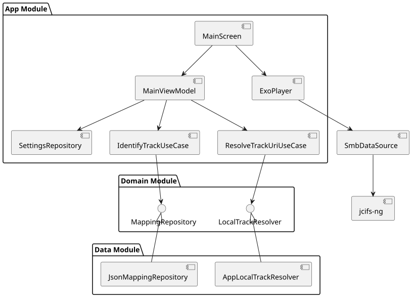

# 01 Module Overview

The project is structured into two main modules to ensure separation of concerns and testability.

## Module `:core` (Android Library)
Responsible for platform-independent business logic and data models.
- **`mapping`**: Contains `MappingLoader` for JSON parsing and `TrackPathResolver` for file path generation.
- **`model`**: Defines core entities like `Song`, `MappingFile`, and `PlaybackSettings`.
- **`qr`**: `QrUtils` for normalizing and parsing QR code content.

## Module `:app` (Android Application)
Contains UI components, hardware interactions, and Android-specific services.
- **`camera`**: `CameraPreview` using CameraX and ML Kit for barcode scanning.
- **`player`**: `SmbDataSource` integrating Media3/ExoPlayer with the SMB protocol.
- **`offline`**: `OfflineLibrarySyncService` and `OfflineLibraryStorage` for local file caching.
- **`settings`**: `SettingsRepository` using Jetpack DataStore for reactive configuration.
- **`ui`**: Jetpack Compose screens (`MainScreen`, `SettingsScreen`) and theme definitions.

---

## Component Diagram

