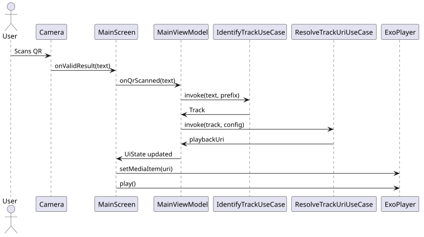

# 02 Runtime Flow

The process from capturing a QR code to playing the music follows a structured pipeline:

1.  **QR Scanning**: The camera captures a QR code via `CameraPreview`, and ML Kit extracts the raw text.
2.  **Parsing**: `QrUtils.parseQr` normalizes the text and extracts the `urlPart` (optional) and `trackId`.
3.  **Mapping Lookup**:
    -   `AssetMappingLoader` aggregates JSON mapping files from assets and local offline storage.
    -   `MappingLoader.parse` converts these into a map of `SongKey` to `Song`.
    -   The `Song` is identified by the combination of `urlPart` and `trackId`.
4.  **Path Resolution**:
    -   **Step A**: `OfflineLibraryStorage` checks if the track file exists locally in the offline cache.
    -   **Step B (Fallback)**: If not found locally, `TrackPathResolver.resolve` uses NAS settings (`nasAddress`, `nasBaseFolder`) to build a remote path.
5.  **SMB URI Generation**: The resolved path is converted into a valid `smb://` URI.
6.  **Playback**: `ExoPlayer` uses `SmbDataSource` to stream the audio file via the SMB protocol (using `jcifs-ng`).

---

## Sequence Diagram
See [diagrams/src/02_sequence.puml](diagrams/src/02_sequence.puml)

