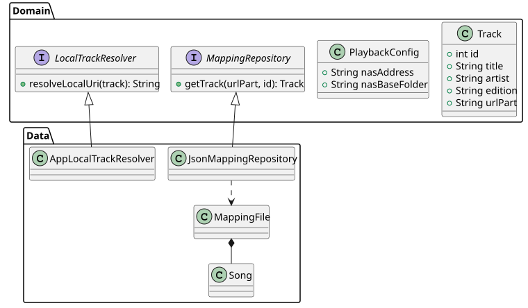

# 03 Data Models

The system relies on a set of core models to represent music tracks and application state.

## Domain Models
- **`Track`**: The primary entity representing a music track in the domain layer.
- **`PlaybackConfig`**: Contains configuration for path resolution.

## Data Models (DTOs)
- **`MappingFile`**: Represents the JSON structure of a mapping file.
- **`Song`**: The data representation of a song in the JSON file.

---

## Class Diagram
See [diagrams/src/03_class.puml](diagrams/src/03_class.puml)

