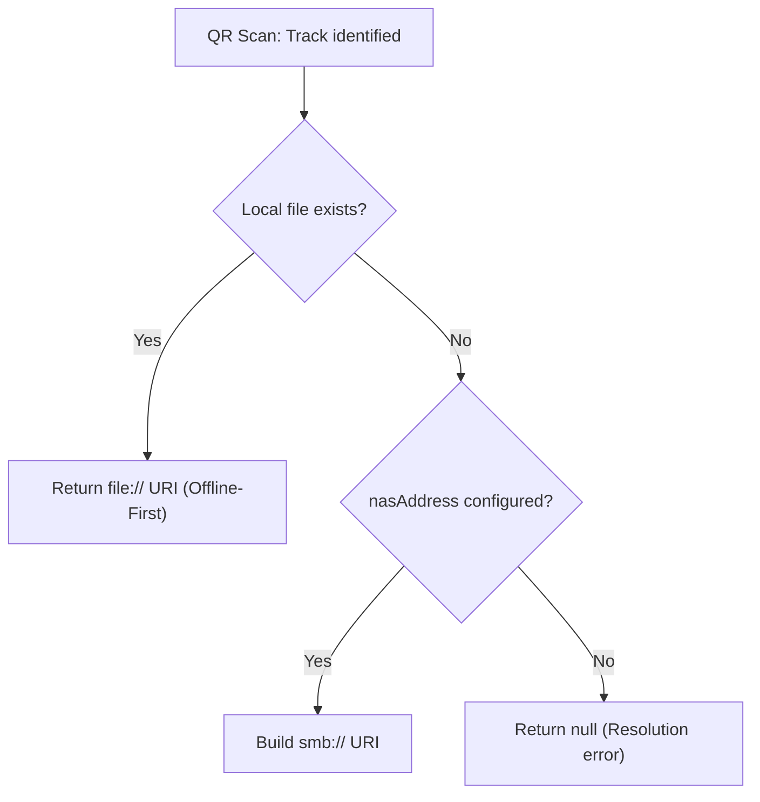

# 05 Path Resolution

Path resolution logic is centralized in `ResolveTrackUriUseCase` within the `:domain` module, using `LocalTrackResolver` for local offline storage checks.

## Resolution Logic

The path resolution pipeline executes in order:

### 1. Offline-First Check (`LocalTrackResolver`)

The resolver checks the local storage directory (`context.filesDir/offline-library/editions/<SanitizedEdition>/`):

- **Explicit `nasLocation`:**
  1. Checks `<SanitizedEdition>/<nasLocation>` (with path separators normalized).
  2. Fallback: Checks `<SanitizedEdition>/<trackFolderName>/<filename>` using the file name component of `nasLocation`.
- **Standard Numbered Track:**
  1. Pads the numeric track ID to `trackIdPadding` digits (e.g. `001.mp3` for ID 1 with padding 3).
  2. Checks `<SanitizedEdition>/<trackFolderName>/<paddedTrackId>.mp3`.

If any candidate exists on disk, its URI (`file:/...`) is returned immediately and playback occurs locally.

### 2. NAS Path Construction (Network Fallback)

If the track is not present locally, a remote UNC path is constructed:

- **Explicit `nasLocation`:**
  `\\<nasAddress>\<nasLocation>`
- **Standard Numbered Track:**
  `\\<nasAddress>\<nasBaseFolder>\<edition>\<trackFolderName>\<paddedTrackId>.mp3`

### 3. SMB URI Normalization

The resulting UNC path is normalized into an `smb://` URI:
`\\server\share\path\file.mp3` $\rightarrow$ `smb://server/share/path/file.mp3`
Media3 ExoPlayer routes this URI through `SmbDataSource`.
